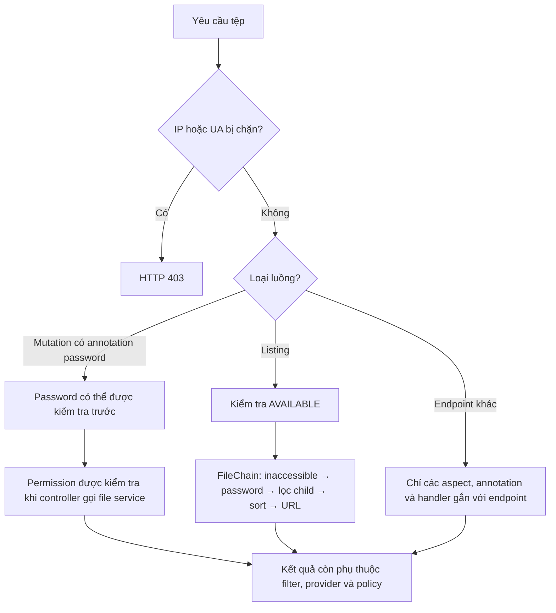

# Quyết định truy cập và hiển thị

Một user chỉ nhận được kết quả tệp khi vượt qua các rule đúng loại: assignment và permission quyết định thao tác, password bảo vệ path, filter xử lý truy cập/hiển thị/download. Request chưa đăng nhập dùng anonymous user ID `2`; trước các rule này, `SecurityFilter` có thể chặn toàn cục theo IP hoặc `User-Agent`.

## Các lớp quyết định cho file operation

Bảng sau mô tả điều kiện của từng lớp, không phải thứ tự runtime chung cho mọi endpoint. Các lớp này cũng áp dụng khi danh tính hiện tại là anonymous user ID `2`. Ở mutation endpoint có annotation password, password có thể được kiểm tra trước permission thao tác; riêng listing dùng thứ tự của `FileChain` mô tả bên dưới.

| Lớp | Câu hỏi | Không đạt | Đạt |
| --- | --- | --- | --- |
| 1 | User hiện tại có bật không? | Từ chối operation. | Sang bước 2. |
| 2 | Có `UserStorageSource` đang bật cho storage source không? | **Caveat:** assignment thiếu hiện có thể gây null dereference trong `allowAccess`, thay vì một lỗi từ chối sạch. Assignment tắt thì bị từ chối. | Sang bước 3. |
| 3 | Operation có phải `AVAILABLE` không? | Sang bước 4. | Cho phép ở lớp permission. |
| 4 | `permissions` có operation tương ứng không? | Từ chối operation. | Cho phép ở lớp permission. |
| 5 | Endpoint có `@CheckPassword` và path khớp rule password không? | Không áp dụng hoặc không khớp: tiếp tục. | Thiếu/sai password: báo lỗi; đúng: tiếp tục. |
| 6 | Path khớp filter không? | Không khớp: tiếp tục. | Kết quả phụ thuộc call site; xem caveat filter bên dưới. |

## Rule theo path

- `CheckPasswordAspect` ghép user base path với request path. Nếu request là file, nó dùng parent path để kiểm tra password.
- `IGNORE_PASSWORD` bỏ qua password check. Rule trống hoặc không có rule khớp thì password check thành công.
- `IGNORE_HIDDEN` làm `FilterConfigService#testPattern` trả `false` cho mọi danh sách rule. Vì inaccessible, hidden và disable-download đều dùng method này, quyền đó hiện bỏ qua cả ba loại filter.
- Khi liệt kê, `FileHiddenCommand` gọi `checkFileIsHidden` cho từng child. Method này nạp toàn bộ rule bằng `findByStorageId`, không lọc `mode`, rồi loại mọi child có full path khớp. Vì vậy rule inaccessible hoặc disable-download cũng có thể làm child biến mất khỏi danh sách.
- Khi download, hệ thống kiểm tra rule disable-download cho cả file path và parent path nếu file có parent.

## Thứ tự thực thi và ý nghĩa permission

- Mutation có `@CheckPassword`/`@CheckPasswords`: password aspect bọc controller; permission aspect chỉ chạy khi controller gọi file service. Password vì vậy có thể chạy trước permission thao tác.
- Listing: `fileList()` trước hết đi qua permission `AVAILABLE`; sau đó `FileChain` chạy inaccessible → password thư mục → lọc child → sort → xử lý URL download/preview.
- `PREVIEW` và `DOWNLOAD` chủ yếu định hình response. `FileDownloadPermissionCommand` chỉ xóa `url` khi thiếu cả hai; có `PREVIEW` nhưng thiếu `DOWNLOAD` vẫn giữ URL. `DOWNLOAD` không phải hàng rào truy cập tuyệt đối và không giới hạn direct/short link.
- `SHARE_LINK` và `SHORT_LINK` hiện không được `FileOperatorCheckAspect#annotationCheck` enforce. Aspect chỉ kiểm tra khi action là `LINK`; với hai action còn lại, nó cho controller chạy tiếp dù annotation vẫn hiện diện.

`StorageSource.enable` cũng cần được hiểu đúng phạm vi: truy vấn danh sách source dùng cờ này để ẩn source khỏi discovery, nhưng ordinary `FileOperatorCheckAspect#allowAccess` không đọc nó. Cờ `UserStorageSource.enable` mới là trạng thái assignment được aspect kiểm tra.

## Rule cho khách qua link

Khách không đi qua bảng permission của user như một file operation thông thường. Với share link, hệ thống kiểm tra link tồn tại/chưa hết hạn và password khi thao tác cần nội dung. Với direct/short link, source còn kiểm tra storage source khởi tạo và bật, disable-download filter, Referer policy và rate limit khi các cấu hình tương ứng bật.

**Caveat implementation:** không dùng việc source biến mất khỏi danh sách hoặc nút download bị ẩn làm bằng chứng rằng backend đã thu hồi mọi đường truy cập. Chỉ các endpoint/method có aspect, annotation, filter hoặc handler đã khảo sát mới có bảo đảm nêu ở đây.

## Đọc sâu

- [Kiểm soát truy cập](../access-control) cho aspect, lỗi và chi tiết filter/password.
- [Chia sẻ và liên kết](../sharing-and-links) cho policy của khách truy cập.
- `FileOperatorCheckAspect#allowAccess`, `FileOperatorCheckAspect#annotationCheck`, `CheckPasswordAspect#around`, `FileChain#init`, `FileHiddenCommand`, `FileDownloadPermissionCommand`, `FilterConfigService`, `ZFileAuthUtil`, `SecurityFilter`, `LinkDownloadService`.
