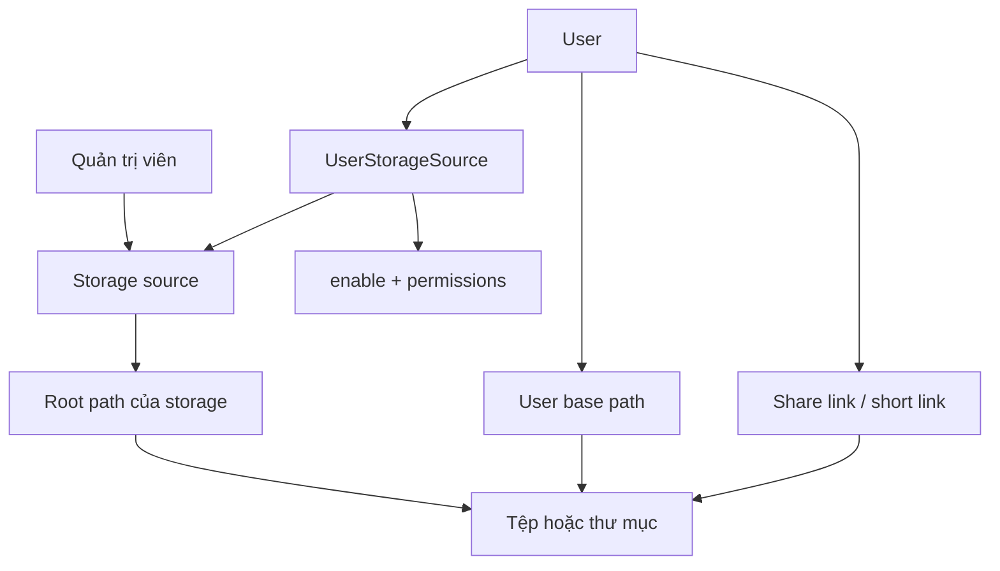

# Mô hình business

Để một người dùng làm việc đúng nơi và chia sẻ đúng tệp, ZFile phải nối cấu hình lưu trữ, quyền của người dùng và đường dẫn tệp thành một phạm vi rõ ràng.

## Đối tượng và quan hệ

| Đối tượng | Vai trò business | Ownership hoặc quan hệ đã xác minh |
| --- | --- | --- |
| Storage source | Cấu hình kết nối một backend lưu trữ | Có `id`, `key`, type và parameter; `StorageSourceContext` khởi tạo file service theo source này. |
| `UserStorageSource` | Bản cấp quyền của một user trên một storage source | Liên kết user, storage source, `enable` và `permissions`. |
| Anonymous user | Danh tính fallback cho request chưa đăng nhập | `ZFileAuthUtil` dùng user ID `2`; quyền duyệt và thao tác được lấy từ assignment của user này. |
| User base path | Gốc đường dẫn dành cho user | File service ghép vào một số thao tác; khi tạo share link, `sharePath` được lưu kèm base path hiện tại. |
| Tệp/thư mục | Nội dung mà user duyệt hoặc thao tác | Được file service của storage source xử lý theo `storageKey` và path. |
| Share link | Phạm vi công khai một phần nội dung | Gắn với storage source, đường dẫn chia sẻ, entry, password tùy chọn và ngày hết hạn tùy chọn. |

`storageKey` là định danh được request dùng để tìm storage source và file service. Vì vậy nó nối ý định của user với đúng provider, không chỉ là một nhãn hiển thị.

## Ownership cần nhớ

- Quản trị viên tạo/cập nhật/bật storage source; source mới nhận default permission cho các user theo cấu hình hiện có.
- User không sở hữu storage source chỉ vì nhìn thấy source đó. `UserStorageSource.enable` là trạng thái assignment mà ordinary permission aspect kiểm tra.
- `StorageSource.enable` có phạm vi khác: truy vấn discovery chỉ trả source đang bật, nhưng `FileOperatorCheckAspect#allowAccess` không kiểm tra cờ này. Source bị ẩn khỏi danh sách chưa đồng nghĩa mọi URL đã biết đều bị chặn.
- Anonymous user ID `2` cũng có thể có `UserStorageSource`; anonymous browsing vì vậy tuân theo assignment và permission của user này.
- User tạo share link; chỉ người tạo hoặc admin được xóa share link đó.
- Khi xóa storage source, hệ thống xóa các liên kết user-storage liên quan. Khi sao chép storage source hoặc user, listener sao chép các liên kết tương ứng.

## Trạng thái tác động outcome

| Trạng thái | Ý nghĩa thực tế |
| --- | --- |
| Storage source chưa khởi tạo hoặc kết nối lỗi | Không có file service sẵn sàng để xử lý tệp. |
| `StorageSource.enable=false` | Source không xuất hiện trong danh sách discovery; ordinary permission aspect không dùng cờ này để từ chối file operation. |
| `UserStorageSource.enable=false` | Permission aspect từ chối file operation của user trên source đó. |
| Không có `UserStorageSource` | **Caveat implementation:** `allowAccess` hiện có thể null dereference thay vì trả lỗi từ chối nghiệp vụ sạch. |
| Chỉ có `PREVIEW` hoặc chỉ có `DOWNLOAD` | Trong response danh sách, URL vẫn được giữ nếu có ít nhất một trong hai quyền. Hai quyền này chủ yếu định hình response, không tạo hàng rào truy cập tuyệt đối. |
| Permission `SHARE_LINK` hoặc `SHORT_LINK` | **Caveat implementation:** controller có annotation tương ứng, nhưng `FileOperatorCheckAspect#annotationCheck` chỉ enforce `LINK`; hai permission này hiện không quyết định việc tạo link. |
| Share link hết hạn hoặc bị xóa | Nội dung chia sẻ không còn hợp lệ. |
| Provider không hỗ trợ operation | Request không thể hứa hẹn thành công chỉ từ permission. |

`SecurityFilter` là lớp toàn cục ngoài mô hình assignment: mọi URL dưới `/*` đều có thể bị trả HTTP `403` nếu IP hoặc `User-Agent` khớp blocklist, trước khi controller xử lý actor và object ở trên.

**Chưa xác minh:** source đã khảo sát không cung cấp một ma trận đầy đủ giữa từng provider và từng file operation/preview. Không suy ra hỗ trợ từ việc source được cấu hình thành công.

## Đọc sâu

- [Storage source](../storage-sources) cho vòng đời cấu hình và khởi tạo.
- [Danh tính và quản trị](../identity-and-administration) cho vòng đời `UserStorageSource`.
- [Chia sẻ và liên kết](../sharing-and-links) cho dữ liệu và vòng đời link.
- `StorageSourceService#saveStorageSource`, `StorageSourceService#findAllEnableOrderByOrderNum`, `StorageSourceMapper#findUserEnableList`, `StorageSourceContext`, `UserStorageSourceService`, `FileOperatorCheckAspect#allowAccess`, `FileOperatorCheckAspect#annotationCheck`, `FileDownloadPermissionCommand`, `ZFileAuthUtil`, `SecurityFilter`, `ShareLinkService#createShareLink`.
