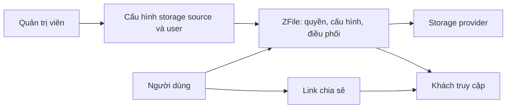

# Mục đích hệ thống

ZFile giúp một cá nhân hoặc nhóm nhỏ truy cập, quản lý, xem trước và chia sẻ tệp nằm trên nhiều nơi lưu trữ từ một giao diện. Kết quả nghiệp vụ là người dùng không phải làm việc trực tiếp với từng storage provider cho các việc thường ngày.

Trang này dành cho developer mới. Hãy hiểu outcome và các vai trò trước khi đọc controller hoặc service.

## ZFile làm gì và không làm gì?

ZFile quản lý cấu hình kết nối, quyết định quyền truy cập và điều phối thao tác tệp tới storage provider. Tệp vẫn do provider phía sau xử lý thông qua implementation của `AbstractBaseFileService`; ZFile không được tài liệu nguồn mô tả là nơi thay thế provider đó.

README xác nhận ZFile hỗ trợ nhiều storage source, gồm S3, OneDrive, SharePoint, Google Drive, local storage, FTP và SFTP; đồng thời hỗ trợ preview image, audio/video, text, PDF, Office và OBJ. Khả năng cụ thể vẫn phụ thuộc provider và cấu hình của bản cài đặt.

## Ai nhận giá trị?

| Vai trò | Mục tiêu | Việc đã xác minh |
| --- | --- | --- |
| Quản trị viên | Chuẩn bị nơi làm việc an toàn cho người dùng | Quản lý storage source, user và system setting. |
| Người dùng đã đăng nhập | Làm việc với tệp được cấp | Duyệt storage source, thao tác tệp theo permission và tạo link chia sẻ. |
| Khách truy cập | Nhận tệp được chia sẻ | Mở link hợp lệ, có thể phải qua password, policy hoặc giới hạn download. |

## Cách học tiếp

1. Đọc [Mô hình business](./business-model) để biết đối tượng nào sở hữu dữ liệu và đường dẫn.
2. Đọc [Quyết định truy cập và hiển thị](./access-and-visibility) trước khi suy luận rằng một request luôn được phép.
3. Đọc [Các workflow cốt lõi](./core-workflows) để ghép các domain thành outcome hoàn chỉnh.

## Nguồn và đọc sâu

- [Tổng quan sản phẩm](../overview): mục tiêu sản phẩm, actors và ranh giới hệ thống.
- [Bản đồ domain](../domain-map): các domain và điểm vào source đã xác minh.
- `zfile/README.md`, mục `主要特性`.
- `im.zhaojun.zfile.module.storage.service.base.AbstractBaseFileService`.
