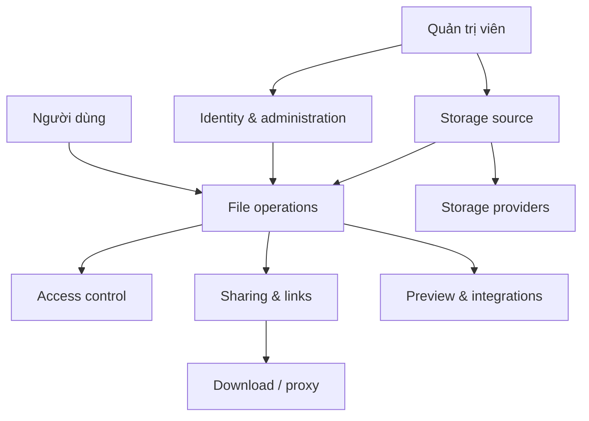

# Bản đồ domain

Bản đồ này cho biết domain nào chịu trách nhiệm cho từng nhóm khả năng của ZFile và nơi bắt đầu lần theo source code. Phần business đứng trước; tên class và module ở phần kỹ thuật là điểm vào, không phải sơ đồ call chain đầy đủ.

## Bản đồ tổng thể

## Các domain

| Domain | Trách nhiệm | Actors chính | Điểm vào source đã xác minh |
| --- | --- | --- | --- |
| Storage source | Lưu metadata, cấu hình, khởi tạo, xóa, sao chép và cung cấp danh sách storage source cho user. | Quản trị viên | `StorageSourceService`, `StorageSourceContext`, `StorageSourceController` |
| File operations | Đọc danh sách tệp, thông tin tệp và thực hiện tạo thư mục, upload, delete, rename, move hoặc copy. | Người dùng | `FileController`, `FileOperatorController`, `AbstractBaseFileService` |
| Access control | Quyết định user có thể truy cập storage source và thực hiện một loại file operation hay không; kiểm tra password cho endpoint có `@CheckPassword`. | Người dùng, quản trị viên | `FileOperatorCheckAspect`, `CheckPasswordAspect`, `UserStorageSourceService` |
| Sharing & links | Tạo và quản lý share link; phân giải direct link, short link và download URL. | Người dùng, khách truy cập | `ShareLinkService`, `ShareLinkController`, `DirectLinkController`, `ShortLinkController`, `LinkDownloadService` |
| Identity & administration | Đăng nhập, logout, kiểm tra session, xác định admin và quản lý user. | Người dùng, quản trị viên | `UserController`, `UserService`, `SsoService` |
| Preview & integrations | Cung cấp preview; tích hợp OnlyOffice và các implementation tương ứng với loại storage. | Người dùng, dịch vụ ngoài | module `onlyoffice`, `StorageTypeEnum`, implementation của `AbstractBaseFileService` |

## Quan hệ chính

1. `Storage source` cung cấp file service thông qua `StorageSourceContext`.
2. `File operations` gọi file service phù hợp với `storageKey` để xử lý tệp.
3. `Access control` được áp dụng quanh các method của `AbstractBaseFileService` cho các thao tác như duyệt, tạo thư mục, upload, delete, rename, move và copy.
4. `Sharing & links` dùng storage source và file service để tạo hoặc xử lý link đến tệp.
5. `Identity & administration` ảnh hưởng phạm vi storage source và quyền mà người dùng có thể sử dụng.

## Quy tắc đã xác minh

- Người dùng không được cấp hoặc bị tắt trên một storage source sẽ bị từ chối mọi file operation tại `FileOperatorCheckAspect.allowAccess()`.
- Với loại `AVAILABLE`, access control chỉ yêu cầu storage source đã được cấp và bật; các thao tác khác cần permission tương ứng trong `UserStorageSource.permissions`.
- `CheckPasswordAspect` xác minh password theo storage source và đường dẫn trước khi gọi method có annotation `@CheckPassword` hoặc `@CheckPasswords`.
- Khi tạo storage source mới, `StorageSourceService.saveStorageSource()` thêm default permission cho tất cả user theo cấu hình hiện có.

## Điều chưa xác minh

- Không liệt kê toàn bộ route runtime vì một phần route có thể được đăng ký từ `system_config`.
- Không khẳng định mọi storage provider đều hỗ trợ tất cả file operation; hành vi cụ thể sẽ được mô tả theo domain ở các phase sau.

## Đọc tiếp

- Đọc [Tổng quan sản phẩm](./overview) để biết mục tiêu và actors.
- Đọc [Thuật ngữ](./glossary) trước khi dùng các khái niệm domain trong trao đổi nghiệp vụ.

## Nguồn

- `im.zhaojun.zfile.module.storage.service.StorageSourceService#saveStorageSource`.
- `im.zhaojun.zfile.module.storage.context.StorageSourceContext`.
- `im.zhaojun.zfile.module.storage.controller.file.FileController`.
- `im.zhaojun.zfile.module.storage.controller.file.FileOperatorController`.
- `im.zhaojun.zfile.module.storage.aspect.FileOperatorCheckAspect#allowAccess`.
- `im.zhaojun.zfile.module.storage.aspect.CheckPasswordAspect#around`.
- `im.zhaojun.zfile.module.share.service.ShareLinkService`.
- `im.zhaojun.zfile.module.link.service.LinkDownloadService`.
- `im.zhaojun.zfile.module.user.controller.UserController`.
