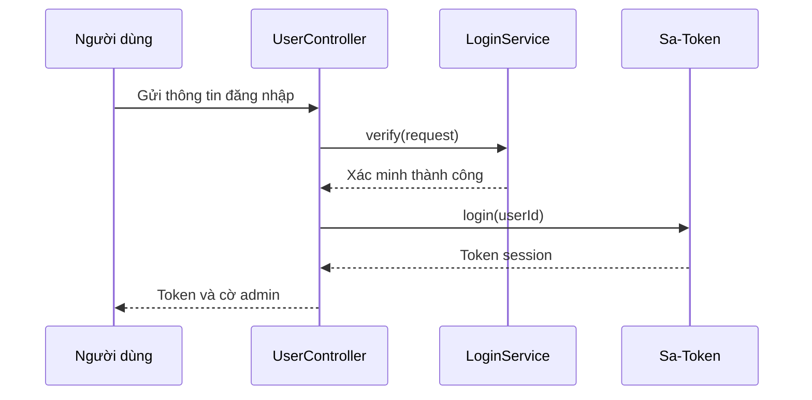

# Danh tính và quản trị

ZFile xác định người đang làm việc, giới hạn ai được quản trị hệ thống và cấp quyền dùng từng storage source để thao tác tệp đúng phạm vi.

Phần nghiệp vụ dành cho BA và người vận hành; tên class và endpoint ở mục cuối dành cho lập trình viên mới.

## Mục tiêu business

- Người dùng đăng nhập để có session và làm việc trong phạm vi quyền của mình.
- Quản trị viên quản lý user, cấu hình hệ thống và storage source; đây là quyền quản trị hệ thống, không phải quyền tệp.
- Mỗi người dùng chỉ thấy nguồn lưu trữ đang bật và đã được cấp trong danh sách khám phá. Khi gọi trực tiếp bằng `storageKey`, lớp quyền thao tác kiểm tra trạng thái người dùng, assignment và permission, nhưng không kiểm tra `StorageSource.enable`.
- SSO cho phép dùng danh tính từ một nhà cung cấp bên ngoài để đăng nhập hoặc tạo user mới từ template đã bật.

## Actor và ownership

| Actor | Quyền sở hữu hoặc trách nhiệm đã xác minh |
| --- | --- |
| Người dùng | Sở hữu session của mình; đổi mật khẩu của chính mình sau khi đã đăng nhập. |
| Quản trị viên | Là user có ID `1`; được gán role `admin` để đi vào các API dưới `/admin/**`. |
| `UserStorageSource` | Là bản cấp quyền nối một user với một storage source, gồm `enable` và `permissions`; đây là ownership của quyền tệp. |
| Nhà cung cấp SSO | Xác thực người dùng, cấp access token và trả thông tin user; trường `bindingField` được dùng làm username trong ZFile. |
| User template | Là user ID `0`; SSO sao chép template này để tạo user mới khi template đang bật. |
| Anonymous user | Là user ID `2`; đại diện cho truy cập ẩn danh trong các assignment mặc định. |

## Business objects/lifecycle

| Đối tượng | Vòng đời hoặc trạng thái có ảnh hưởng |
| --- | --- |
| Session | Được tạo sau khi `LoginService#verify` thành công và `StpUtil.login(userId)` chạy; bị kết thúc bởi `StpUtil.logout()`. |
| User | Admin có thể tạo, cập nhật, bật/tắt, sao chép và xóa user. Ba user hệ thống có vai trò cố định: template ID `0`, admin ID `1` và anonymous ID `2`. Các user này không được xóa. |
| `UserStorageSource` | Phải tồn tại và đang bật thì user mới dùng được storage source. Với thao tác khác `AVAILABLE`, `permissions` phải chứa quyền tương ứng. |
| Cấu hình SSO | Admin có thể tạo, cập nhật, bật/tắt và xóa provider. Provider phải tồn tại và đang bật thì mới bắt đầu đăng nhập. Callback lấy `code`, đổi lấy Bearer token, gọi user-info, rồi tìm hoặc tạo user. |
| Ràng buộc 2FA | Secret 2FA được gắn với user quản trị. Khi admin bật xác minh hai bước và user có `loginVerifySecret`, đăng nhập dùng mã 2FA thay cho captcha. |
| System setting | Chỉ field đã tồn tại trong cấu hình hệ thống mới được cập nhật. Giá trị thay đổi được xử lý bởi chuỗi `ISystemConfigModifyHandler` trước khi ghi. |

### Vòng đời user và assignment

1. Khi tạo user, admin gửi thông tin user cùng danh sách assignment storage source. Hệ thống lưu user trước rồi lưu các `UserStorageSource` tương ứng.
2. Khi cập nhật user, hệ thống thay thế toàn bộ danh sách assignment: xóa các liên kết cũ rồi lưu danh sách mới. Client phải gửi lại cả những assignment muốn giữ, không chỉ phần thay đổi.
3. Bật hoặc tắt user thay đổi `enable`. User bị tắt không qua được kiểm tra file operation.
4. Khi sao chép user, listener sao chép các assignment của user nguồn sang user mới.
5. Khi xóa user, hệ thống xóa các assignment liên quan. Template ID `0`, admin ID `1` và anonymous ID `2` không được xóa.

Khi tạo storage source mới, hệ thống áp dụng default permission của từng user vào source đó. Khi xóa source, các liên kết user-storage liên quan bị xóa; khi sao chép source, listener sao chép các liên kết tương ứng. Sau khi cập nhật user đã có ID, cache storage source đang bật của user được xóa.

## Workflow

### Đăng nhập bằng mật khẩu

### Đăng nhập SSO

1. Người dùng mở `/sso/{provider}/login`; controller tạo `state`, lưu trong `HttpSession` và chuyển hướng đến trang ủy quyền của provider.
2. Provider trả về callback kèm `code` và `state`. Callback chỉ tiếp tục khi `state` khớp giá trị đã lưu trong session.
3. ZFile đổi `code` lấy Bearer access token, gọi user-info endpoint và đọc `bindingField` làm username.
4. Nếu username đã có, ZFile đăng nhập user đó. Nếu chưa có, hệ thống sao chép user template ID `0` khi template đang bật; nếu không, callback trả lỗi.
5. Nếu có `frontDomain`, hệ thống chuyển hướng đến `{frontDomain}/sso?token={token}`; nếu không, chuyển về backend domain do `SystemConfigService#getAxiosFromDomainOrSetting` xác định.

Callback SSO tìm user theo username rồi tạo session mà không kiểm tra `User.enable` trong nhánh này. Vì vậy một user đã bị tắt vẫn có thể xác thực qua SSO. Đây không phải quyền truy cập tệp: `FileOperatorCheckAspect` kiểm tra lại trạng thái user và từ chối file operation ở bước sau.

## Rules/exception

| Điều kiện | Kết quả đã xác minh |
| --- | --- |
| Đăng nhập quá 10 request trong 60 giây | Endpoint đăng nhập bị giới hạn bởi `@ApiLimit`. |
| `loginImgVerify` bật | Chế độ xác minh đăng nhập là captcha, trừ khi điều kiện 2FA của admin bên dưới được thỏa mãn. |
| User là admin, `adminTwoFactorVerify` bật và `loginVerifySecret` không rỗng | Chế độ xác minh là 2FA. |
| Admin tạo hoặc thay đổi ràng buộc 2FA | Secret được lưu trên user quản trị; cấu hình hệ thống quyết định có yêu cầu mã này khi đăng nhập hay không. |
| Đổi mật khẩu | Phải đăng nhập; nếu user đã có password thì old password phải đúng, và new password phải trùng confirm password. |
| Request vào `/admin/**` | Phải đăng nhập và có role `admin`; `/admin` được loại khỏi interceptor để dùng làm trang đăng nhập. |
| Xóa user có ID từ `0` đến `2` | Bị từ chối; các ID này lần lượt gồm template, admin và anonymous. |
| User hoặc liên kết `UserStorageSource` không bật | Thao tác tệp bị từ chối. `StorageSource.enable` chỉ được kiểm tra ở discovery và một số handler như direct/short link, không phải mọi file operation. |
| Provider SSO không tồn tại, bị tắt, trả token không phải Bearer, hoặc không đọc được `bindingField` | Luồng SSO trả trang lỗi. |
| Danh sách assignment khi cập nhật user thiếu một source đang có | Assignment của source đó bị xóa do thao tác cập nhật thay thế toàn bộ danh sách. |

`secureLoginEntry` và `directLinkPrefix` thay đổi mapping runtime tương ứng của đường đăng nhập và direct link. `secureLoginEntry` chỉ chấp nhận chữ cái, số, `_`, `-` và tối đa 32 ký tự.

**Chưa xác minh:** thời hạn token, nơi lưu token, hành vi đa thiết bị của Sa-Token; toàn bộ điều kiện từ chối trong `LoginVerifyService`; validation cấu hình SSO và biện pháp bảo vệ `clientSecret`; ảnh hưởng bảo mật của token trên query string khi dùng `frontDomain`.

## Scenario

Một user được cấp storage source A với `enable=true` và chỉ có quyền `AVAILABLE`. User đăng nhập thành công nên có session và có thể duyệt A. Khi user upload hoặc xóa, `FileOperatorCheckAspect` vẫn từ chối vì `permissions` không có `UPLOAD` hoặc `DELETE`. Việc cấp toàn bộ quyền tệp trên A cũng không biến user thành admin: chỉ user ID `1` nhận role `admin`.

## Vị trí trong mã nguồn

| Vai trò | Vị trí nguồn |
| --- | --- |
| Đăng nhập, logout, kiểm tra session và đổi mật khẩu | `im.zhaojun.zfile.module.user.controller.UserController` |
| Xác định role admin | `im.zhaojun.zfile.core.config.security.StpInterfaceImpl`, `UserService#isAdmin` |
| Tạo, cập nhật, bật/tắt, sao chép và xóa user | `im.zhaojun.zfile.module.user.controller.UserManagerController`, `im.zhaojun.zfile.module.user.service.UserService` |
| Gắn và xác minh 2FA của admin | `im.zhaojun.zfile.module.user.controller.AdminTwoFAController` |
| Cấp quyền user-storage và kiểm tra thao tác tệp | `im.zhaojun.zfile.module.user.service.UserStorageSourceService`, `im.zhaojun.zfile.module.storage.aspect.FileOperatorCheckAspect` |
| SSO redirect và callback | `im.zhaojun.zfile.module.sso.controller.SsoController`, `im.zhaojun.zfile.module.sso.service.SsoService` |
| Quản lý provider SSO | `im.zhaojun.zfile.module.sso.controller.SsoManagerController`, `im.zhaojun.zfile.module.sso.service.SsoService` |
| Đọc/cập nhật system setting | `im.zhaojun.zfile.module.config.controller.SettingController`, `im.zhaojun.zfile.module.config.service.SystemConfigService` |
| Cập nhật mapping runtime | `SecureLoginEntryModifyHandler`, `DirectLinkPrefixModifyHandler` |
