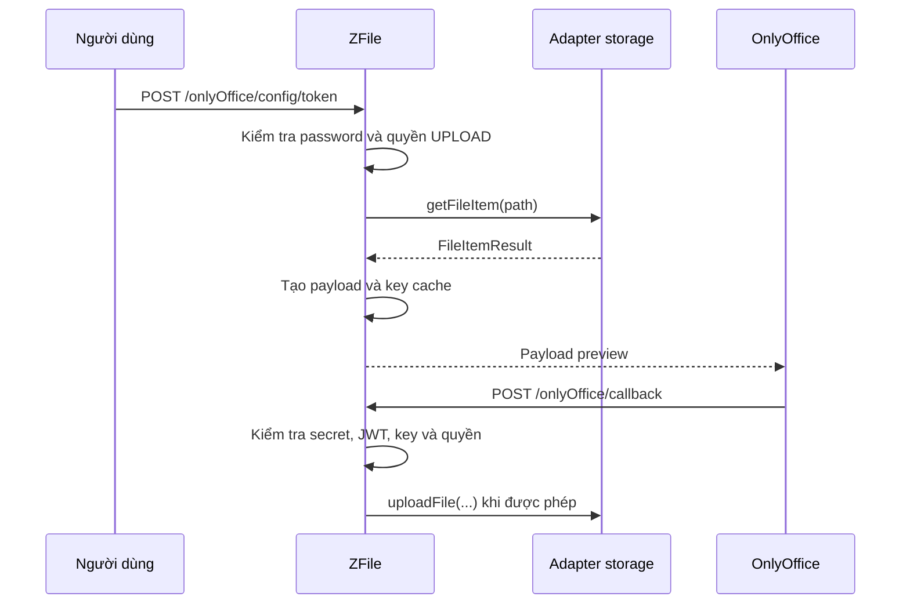

# Xem trước và tích hợp

ZFile lấy tệp từ storage source để hiển thị nội dung; với Office, ZFile tạo cấu hình cho OnlyOffice và chỉ ghi bản chỉnh sửa trở lại khi callback vượt qua các kiểm tra bảo vệ.

Phần nghiệp vụ dành cho BA và người vận hành; tên class và endpoint ở mục cuối dành cho lập trình viên mới.

## Mục tiêu business

- Người dùng có thể xem trước các định dạng được giao diện và provider hỗ trợ trong phạm vi truy cập của mình.
- Tệp Office có thể được xem hoặc chỉnh sửa qua OnlyOffice. Khả năng chỉnh sửa không chỉ phụ thuộc giao diện mà còn phụ thuộc secret, quyền upload và adapter storage.
- ZFile dùng adapter theo loại storage để tách luồng tệp khỏi từng provider. Một storage source khởi tạo được không có nghĩa provider đó hỗ trợ mọi thao tác hoặc mọi kiểu preview.

## Actor và ownership

| Actor | Quyền sở hữu hoặc trách nhiệm đã xác minh |
| --- | --- |
| Người dùng đã đăng nhập | Yêu cầu preview Office; quyền `UPLOAD` trên storage source quyết định preview có thể cho phép sửa hay không. |
| Khách của share link | Có thể nhận cấu hình OnlyOffice sau khi share và password được kiểm tra; payload luôn chỉ đọc. |
| ZFile | Tạo payload, lưu key preview cùng user đã mở preview, xác thực callback và gọi adapter để ghi lại tệp khi được phép. |
| OnlyOffice Document Server | Nhận payload để hiển thị/chỉnh sửa và gửi callback về ZFile. |
| Adapter storage | Cung cấp `FileItemResult`, URL tệp và, với adapter thuộc `AbstractProxyTransferService`, nhận dữ liệu upload từ callback. |

## Business objects/lifecycle

| Đối tượng | Vòng đời hoặc trạng thái có ảnh hưởng |
| --- | --- |
| `FileItemResult` | Được lấy từ adapter theo `storageKey` và path; cung cấp tên, phần mở rộng và URL cho payload OnlyOffice. |
| Cấu hình OnlyOffice | Chứa `document.url`, `document.key`, quyền `edit`, `callbackUrl` và JWT khi `onlyOfficeSecret` có giá trị. |
| Key cache OnlyOffice | Định danh bằng `storageKey` và full path, trong đó full path gồm user root hoặc share root. Giá trị `3000` trong luồng này là thời gian chờ lấy lock, tính bằng mili giây; không phải TTL 3.000 giây của key. |
| Callback | Chỉ trạng thái `2` và `6` có thể ghi tệp; `3` và `7` chỉ dọn key cache. Các trạng thái khác trả thành công mà không xử lý cache hoặc ghi tệp. |
| Storage source context | Giữ adapter đã khởi tạo theo `storageId` và `storageKey`. Context chỉ cache adapter sau khi `init()` và `testConnection()` thành công. |

Sau delete, upload, rename hoặc move, `FileOperatorCheckAspect` cố xóa key cache OnlyOffice của tệp hoặc thư mục liên quan. Lỗi dọn cache chỉ được log.

## Workflow

### Preview và lưu Office

1. `POST /onlyOffice/config/token` kiểm tra password của tệp, tìm storage source theo `storageKey`, rồi lấy `FileItemResult` từ adapter.
2. ZFile kiểm tra quyền `UPLOAD` của user hiện tại, tạo `OnlyOfficeFile` có user ID và path, sau đó tạo payload OnlyOffice.
3. Nếu `onlyOfficeSecret` rỗng, payload không có JWT và quyền `edit` bị hạ xuống `false`.
4. OnlyOffice gửi callback. ZFile kiểm tra secret, token JWT và key trong token. Với trạng thái cần lưu, key được lấy khỏi cache trước các bước xác minh quyền và truyền tệp tiếp theo.
5. ZFile tiếp tục kiểm tra quyền `UPLOAD` của user đã cache và cờ cho phép sửa khi preview được tạo. Với callback trạng thái `2` hoặc `6`, hệ thống chỉ tải và upload tệp nếu adapter là `AbstractProxyTransferService`.

Việc xóa key trước các bước kiểm tra sau có nghĩa callback có thể tiêu thụ key dù cuối cùng không ghi được tệp, chẳng hạn khi user không còn quyền hoặc truyền tệp lỗi. Lần callback sau không thể dựa vào key cũ để thử lại.

### Khởi tạo adapter storage

`StorageSourceContext` chọn Spring bean có `getStorageTypeEnum()` khớp loại source, nạp parameter, gọi `init()` rồi `testConnection()`. Nếu không tìm thấy adapter hoặc kiểm tra kết nối lỗi, adapter không được cache trong context.

## Rules/exception

| Điều kiện | Kết quả đã xác minh |
| --- | --- |
| `storageKey` không tồn tại khi tạo preview | Ném `InvalidStorageSourceBizException`. |
| Không lấy được thông tin tệp | Luồng preview trả lỗi `Lấy thông tin tệp thất bại: ...`. |
| `onlyOfficeSecret` rỗng | Preview Office chỉ đọc, không có JWT; callback bị từ chối. |
| Callback thiếu token hoặc JWT không hợp lệ | Callback trả `{"error":1}`. |
| Key callback không còn trong cache | Callback trả lỗi. |
| Key body không khớp key trong JWT, preview đã chỉ đọc, hoặc user đã cache không có `UPLOAD` | Không ghi tệp. |
| URL tệp callback | Chỉ nhận `http`/`https`; scheme, host và port phải trùng `onlyOfficeUrl`. Mỗi redirect được kiểm tra lại, tối đa 5 redirect; connect timeout là 5 giây và read timeout là 30 giây. |
| Adapter không phải `AbstractProxyTransferService` | Callback không gọi `uploadFile`; response callback vẫn là thành công nếu không có lỗi kiểm tra trước đó. |

`StorageTypeEnum` công bố các loại: `LOCAL`, `FTP`, `SFTP`, `WEBDAV`, `ALIYUN`, `TENCENT`, `UPYUN`, `HUAWEI`, `MINIO`, `S3`, `QINIU`, `DOGE_CLOUD`, `ONE_DRIVE`, `ONE_DRIVE_CHINA`, `SHAREPOINT_DRIVE`, `SHAREPOINT_DRIVE_CHINA`, `GOOGLE_DRIVE` và `OPEN115`.

**Chưa xác minh:** phần mở rộng nào frontend chuyển sang OnlyOffice; điều kiện UI hiển thị nút preview; cách nhập cấu hình `onlyOfficeUrl`, `onlyOfficeSecret` và callback domain; ma trận end-to-end giữa provider, preview, URL tải và khả năng ghi Office.

## Scenario

Lan có quyền `AVAILABLE` và `UPLOAD` trên storage source A, mở một tệp Office không có password. Khi `onlyOfficeSecret` được cấu hình, payload cho phép sửa và callback trạng thái `2` có thể ghi bản mới về A nếu JWT, key và adapter đều hợp lệ. Nếu bỏ `onlyOfficeSecret`, Lan vẫn nhận payload để xem nhưng `edit=false`; callback bị từ chối nên không có bản chỉnh sửa nào được ghi về storage.

## Vị trí trong mã nguồn

| Vai trò | Vị trí nguồn |
| --- | --- |
| Tạo preview và xử lý callback | `im.zhaojun.zfile.module.onlyoffice.controller.OnlyOfficeController` |
| Tạo payload, JWT và key cache | `im.zhaojun.zfile.module.onlyoffice.service.OnlyOfficeConfigService`, `im.zhaojun.zfile.core.util.OnlyOfficeKeyCacheUtils` |
| Preview Office từ share link | `im.zhaojun.zfile.module.share.controller.ShareLinkController#getShareOnlyOfficeConfigToken` |
| Kiểm tra quyền tệp và dọn cache | `im.zhaojun.zfile.module.storage.aspect.FileOperatorCheckAspect` |
| Loại storage công bố | `im.zhaojun.zfile.module.storage.model.enums.StorageTypeEnum` |
| Chọn, khởi tạo và cache adapter | `im.zhaojun.zfile.module.storage.context.StorageSourceContext` |
| Hợp đồng adapter và upload callback | `im.zhaojun.zfile.module.storage.service.base.AbstractBaseFileService`, `AbstractProxyTransferService` |
