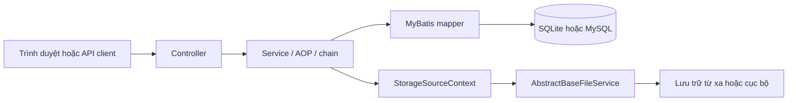

# Tổng quan kiến trúc

ZFile là ứng dụng Spring Boot đóng gói `jar`; `ZfileApplication.main()` khởi tạo Spring, quét component dưới `im.zhaojun.zfile.*`, servlet filter và bật AOP.

## Bootstrap

`ZfileApplication` là entrypoint. Trong lúc tạo bean, `DataSourceBeanPostProcessor` xử lý `HikariDataSource` và `FlywayProperties`: với SQLite, nó tạo thư mục chứa tệp cơ sở dữ liệu và có thể sao lưu tệp khi `zfile.db.version` hiện diện; đồng thời chọn thư mục migration theo driver.

Sau khi Spring có các bean lưu trữ, `StorageSourceInitializer` lấy mọi `AbstractBaseFileService`, nạp chúng vào `StorageSourceContext`, rồi đọc các storage source đã lưu. Mỗi source được ghép cấu hình, khởi tạo và kiểm tra kết nối bằng cách liệt kê thư mục gốc. Một source lỗi chỉ được ghi log; vòng lặp vẫn tiếp tục với source khác.

## Phân rã mã nguồn

| Vùng | Vai trò |
| --- | --- |
| `core/` | Cấu hình, exception, cache, tiện ích, controller gốc và filter dùng chung. |
| `module/` | Chức năng theo domain: `storage`, `user`, `share`, `config`, `permission`, `password`, `link`, `sso` và các module khác. |
| `module/*/controller` | HTTP endpoint; ví dụ `FileController` phục vụ `/api/storage`. |
| `module/*/service` | Điều phối nghiệp vụ, transaction, cache và event. |
| `module/*/mapper` + `resources/mapper` | Interface MyBatis và SQL XML. |
| `resources/db/` | Flyway migration riêng cho SQLite và MySQL. |

## Trừu tượng hóa storage

`AbstractBaseFileService
` là nền chung cho một loại storage. Nó giữ `storageId`, tên, tham số `P`, thực hiện `init()` và xác nhận kết nối qua `fileList("/")` trong `testConnection()`.

`StorageSourceContext` ánh xạ `storageId` và `storageKey` sang service đã khởi tạo. Khi nạp cấu hình, context chọn implementation theo `StorageTypeEnum`, phản chiếu các trường có `@StorageParamItem` vào đối tượng tham số và dùng giá trị mặc định nếu có. Không gọi implementation cụ thể từ controller khi có thể tra qua context.

Khi lưu một source, `StorageSourceService.saveStorageSource()` lưu metadata và tham số, rồi gọi `StorageSourceContext.init()`. Khi xóa, service phát event, hủy context và xóa cache liên quan.

## Ví dụ luồng đọc tệp

`POST /api/storage/files` đi vào `FileController.list()`: xác thực request, đổi `storageKey` thành ID, lấy service từ context, gọi `fileList(path)`, rồi chạy `FileChain`. Chain hiện có các bước kiểm tra quyền truy cập, mật khẩu thư mục, ẩn tệp, sắp xếp và quyền tải xuống.

Nguồn: `ZfileApplication.java`, `DataSourceBeanPostProcessor.java`, `StorageSourceInitializer.java`, `StorageSourceContext.java`, `AbstractBaseFileService.java`, `FileController.java`, `FileChain.java`.
