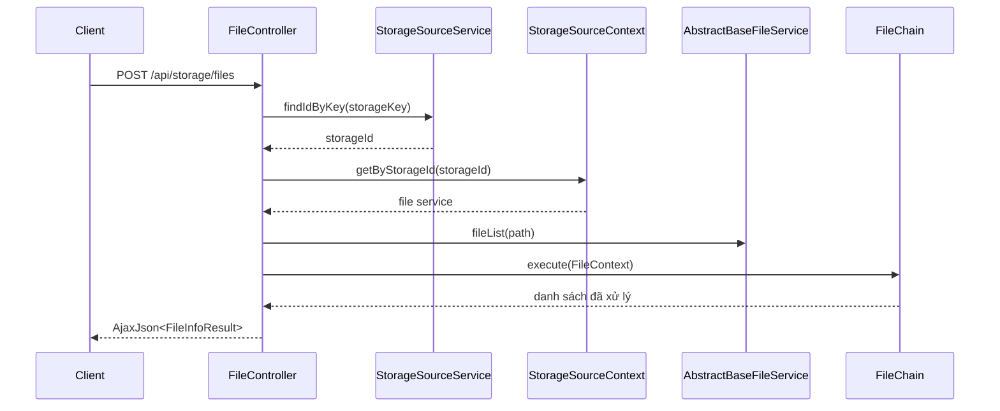
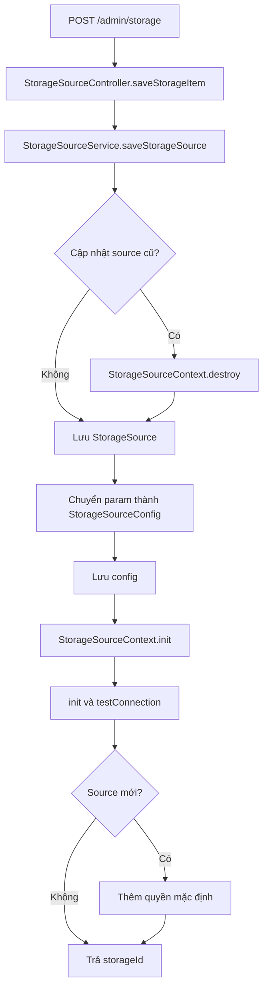
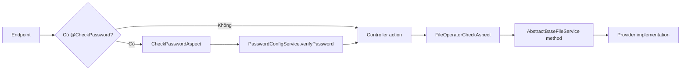
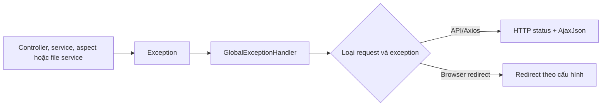

# Luồng mã nguồn

Các flow này cho biết nơi bắt đầu đọc và các thành phần phải kiểm tra trước khi sửa luồng backend ZFile. Xem [Convention mã nguồn](./code-conventions) để chọn đúng tầng đặt thay đổi.

## Request đọc danh sách tệp

`POST /api/storage/files` đi vào `FileController.list()`. Method tra `storageId` theo `storageKey`; nếu không có, nó ném `InvalidStorageSourceBizException`. Sau khi xử lý giá trị mặc định, method lấy provider đã khởi tạo từ context, gọi `fileList(path)` rồi để chain biến đổi danh sách.

`FileChain` chạy lần lượt `FileAccessPermissionVerifyCommand`, `FolderPasswordVerifyCommand`, `FileHiddenCommand`, `FileSortCommand` và `FileDownloadPermissionCommand`. Thay đổi quyền, mật khẩu, ẩn tệp, sort hoặc quyền tải xuống cần xác định command thích hợp và tác động của thứ tự này.

## Lưu storage source

`POST /admin/storage` gọi `StorageSourceController.saveStorageItem()`, sau đó chuyển toàn bộ lifecycle cho `StorageSourceService.saveStorageSource()`.

Luồng này có `@Transactional(rollbackFor = Exception.class)`. Không gọi riêng `StorageSourceContext.init()` từ controller hoặc bỏ qua `StorageSourceConfigService`, vì service đã gắn persistence, context và quyền mặc định thành một chuỗi.

## Quyền và mật khẩu khi thao tác storage

Một lời gọi đến `AbstractBaseFileService` có thể đi qua `FileOperatorCheckAspect`; aspect này kiểm tra quyền tương ứng trước khi cho method chạy. Endpoint gắn `@CheckPassword` hoặc `@CheckPasswords` đi qua `CheckPasswordAspect`, aspect dùng biểu thức trên annotation để đọc `storageKey`, path và password từ argument, rồi gọi `PasswordConfigService.verifyPassword()`.

Điều kiện mới nên được đặt tại annotation/aspect khi cần tái sử dụng cho nhiều endpoint; dùng service khi đó là quy tắc riêng của một use case.

## Chuyển exception thành HTTP response

Controller hoặc service ném exception nghiệp vụ; Spring chuyển nó đến `GlobalExceptionHandler`. Handler có các nhánh riêng cho validation, xác thực, phân quyền, không tìm thấy resource và các exception khác. Với request Axios, một số nhánh trả `AjaxJson`; với request không phải Axios, handler có thể redirect theo cấu hình.

Nguồn: `FileController.list()`, `FileChain.init()`, `StorageSourceController.saveStorageItem()`, `StorageSourceService.saveStorageSource()`, `StorageSourceContext`, `FileOperatorCheckAspect.java`, `CheckPasswordAspect.java`, `GlobalExceptionHandler.java`.
