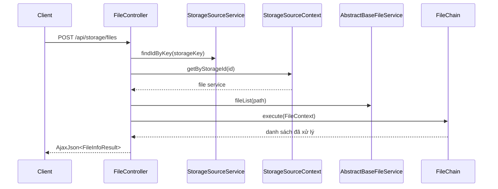

# Điều hướng mã nguồn

Trang này giúp lần từ endpoint đến quy tắc xử lý, tầng lưu trữ dữ liệu và phần triển khai storage. Nếu mới làm quen với repository, bắt đầu từ [Lộ trình làm quen](../onboarding/start-here). Sau đó dùng [Danh mục tính năng](../business/feature-catalog) để xác định miền nghiệp vụ và [Tổng quan kiến trúc](./architecture-overview) để hiểu các tầng chính.

## Bản đồ điểm vào

| Cần tìm | Điểm bắt đầu |
| --- | --- |
| Khởi động ứng dụng | `ZfileApplication.main()` |
| Trang gốc và `/guest` | `core/controller/FrontIndexController` |
| Danh sách và chi tiết tệp | `module/storage/controller/file/FileController` (`/api/storage`) |
| Quản trị storage source | `module/storage/controller/base/StorageSourceController` (`/admin`) |
| Cấu hình site | `module/config/controller/SiteController` (`/api/site`) |
| Người dùng và đăng nhập | `module/user/controller/UserController` (`/user`) |
| Chia sẻ | `module/share/controller/ShareLinkController` (`/api/share`) |
| Log chẩn đoán | `core/controller/LogController` (`/admin/log/download`) |

Controller chỉ là nơi bắt đầu. Theo field được inject sang service, sau đó sang mapper, context hoặc lớp triển khai tương ứng.

Khi luồng chạm đến mapper, migration, datasource hoặc cấu hình runtime, đọc tiếp [Dữ liệu và cấu hình](./data-and-configuration).

## Chuỗi gọi mẫu: liệt kê tệp

Đọc tiếp `FileChain.init()` để biết thứ tự rule. Nếu cần thay đổi một rule, mở command tương ứng thay vì đặt logic mới vào controller.

## Chuỗi gọi mẫu: lưu storage source

`StorageSourceController.saveStorageItem()` gọi `StorageSourceService.saveStorageSource()`.

1. Service chuyển request thành `StorageSource` và lưu bằng `StorageSourceMapper`.
2. `StorageSourceConfigService` đổi tham số thành các bản ghi cấu hình và lưu chúng.
3. `StorageSourceContext.init()` chọn service theo `StorageTypeEnum`, ghép `IStorageParam`, gọi `init()` và `testConnection()`.
4. Với storage source mới, `UserStorageSourceService` thêm quyền mặc định cho người dùng.

Điểm cần xem tiếp: `SaveStorageSourceRequest`, `StorageSourceConfigService`, param class của implementation và mapper XML cùng tên trong `resources/mapper/`.

## Quy tắc tìm kiếm

- Route: tìm annotation `@RequestMapping`, `@GetMapping`, `@PostMapping` hoặc `@DeleteMapping`.
- Dữ liệu: từ `*Mapper.java` sang `resources/mapper/*Mapper.xml`; entity và request/result nằm trong `model/`.
- Storage: từ `StorageTypeEnum` sang implementation kế thừa `AbstractBaseFileService`, sau đó sang param class `IStorageParam`.
- Cross-cutting rule: kiểm tra annotation trên method như `@CheckPassword`, `@ProCheck`, `@DemoDisable` và aspect/chain liên quan.
- Lỗi HTTP: bắt đầu ở `core/exception/GlobalExceptionHandler` và exception dưới `core/exception/biz`.

Sau khi xác định được chuỗi xử lý, dùng [Đóng góp đầu tiên](../onboarding/first-contribution) để rà dữ liệu, storage và phạm vi kiểm tra trước khi sửa mã.

Nguồn: `FileController.java`, `FileChain.java`, `StorageSourceController.java`, `StorageSourceService.java`, `StorageSourceContext.java`.
