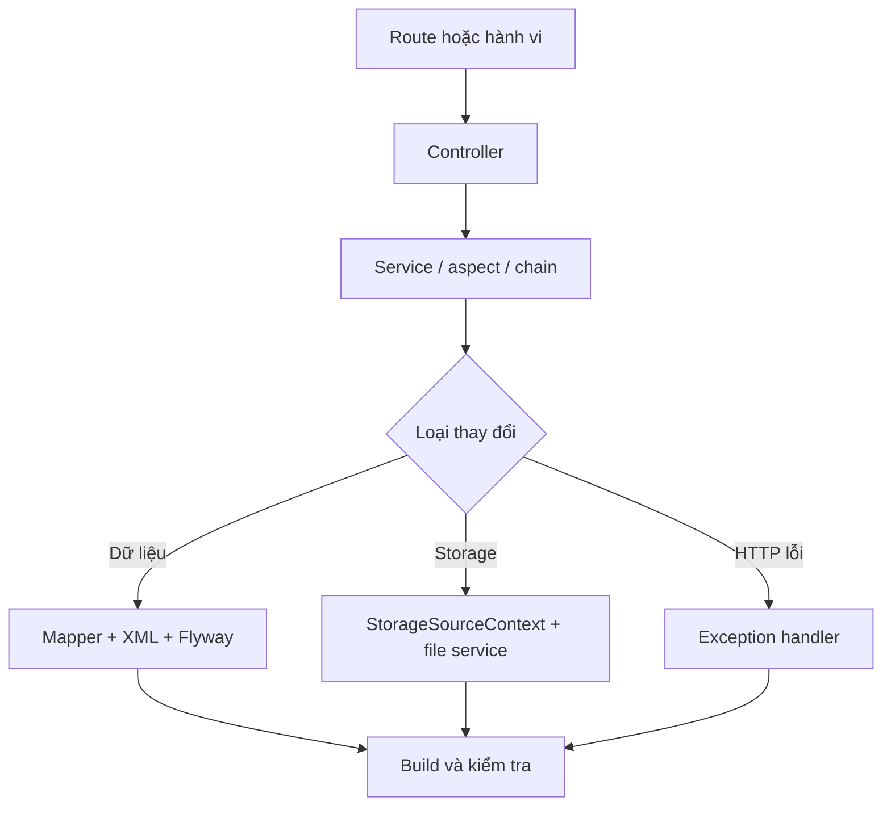

# Đóng góp đầu tiên

Thay đổi đầu tiên nên nhỏ, nằm trong một miền nghiệp vụ và có thể lần từ route đến dữ liệu hoặc hành vi storage. Trước khi chọn việc, hoàn thành [Lộ trình làm quen](./start-here), rồi đọc [Danh mục tính năng](../business/feature-catalog) và [Tổng quan kiến trúc](../engineering/architecture-overview).

## Quy trình

1. Chọn endpoint hoặc hành vi cụ thể, rồi xác định controller bằng route annotation.
2. Theo dependency sang service; kiểm tra validation, annotation AOP, cache, transaction và event trước khi đổi xử lý.
3. Nếu có dữ liệu, lần từ mapper Java sang XML trong `resources/mapper/`; nếu có schema, thêm migration Flyway đúng datasource.
4. Nếu có storage, giữ controller/service dùng `StorageSourceContext` và `AbstractBaseFileService`; không rẽ trực tiếp vào một provider cụ thể khi cần hỗ trợ nhiều loại.
5. Đối chiếu [Điều hướng mã nguồn](../engineering/code-navigation) và [Dữ liệu và cấu hình](../engineering/data-and-configuration), rồi build backend bằng Maven và kiểm tra lại liên kết hoặc tài liệu đã đổi.



## Checklist dữ liệu

- Kiểm tra migration SQLite và MySQL. `DataSourceBeanPostProcessor` chọn thư mục khác nhau theo driver.
- Đặt migration mới theo quy ước `V...__...sql`; không sửa migration đã áp dụng.
- Đồng bộ method mapper, XML statement, entity và DTO/request/result bị ảnh hưởng.
- Không dùng Flyway `clean`: `spring.flyway.clean-disabled=true`.

## Checklist storage

- Tham số provider phải triển khai `IStorageParam`; context map trường cấu hình qua `@StorageParamItem` hoặc tên field.
- Khởi tạo source phải đi qua `StorageSourceContext.init()`, nơi gọi `init()` và `testConnection()`.
- Kiểm tra call chain đọc tệp: `FileController.list()` gọi `fileList()` rồi `FileChain`, trong đó quyền, mật khẩu, ẩn tệp, sort và quyền tải xuống có thứ tự cố định.

## Kiểm tra trong phạm vi đã xác minh

Lệnh build duy nhất được xác nhận từ `pom.xml` là:

```bash
mvn clean package
```

Vì POM đặt `skipTests=true`, lệnh trên bỏ qua test. Đây là lệnh build backend duy nhất có căn cứ từ mã nguồn, không phải bằng chứng rằng test đã chạy hoặc ứng dụng khởi động được. Nguồn hiện tại cũng chưa có mã kiểm thử, `CONTRIBUTING`, cấu hình Compose, quy trình chạy local đã kiểm chứng hoặc quy trình pull request để tài liệu hóa. Không tự bổ sung các bước này theo thông lệ; chỉ ghi rõ việc đã kiểm tra, datasource liên quan và phạm vi chưa kiểm tra.

Nếu phát hiện lỗi và cần ghi nhận thông tin, nêu route hoặc thao tác, dữ liệu đầu vào tối thiểu, kết quả mong đợi và thực tế, phiên bản, datasource cùng log đã che thông tin nhạy cảm. Không đưa token, mật khẩu, thông tin OAuth hoặc tệp log chưa lọc vào nội dung chia sẻ.

Nguồn: `pom.xml`, `DataSourceBeanPostProcessor.java`, `StorageSourceContext.java`, `AbstractBaseFileService.java`, `FileController.java`, `FileChain.java`.

Quay lại [Lộ trình làm quen](./start-here) nếu chưa xác định được miền cần đọc. Khi đã chọn được route hoặc hành vi, dùng [Điều hướng mã nguồn](../engineering/code-navigation) để lần theo chuỗi xử lý.
