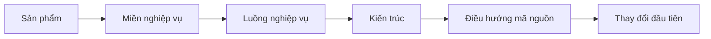
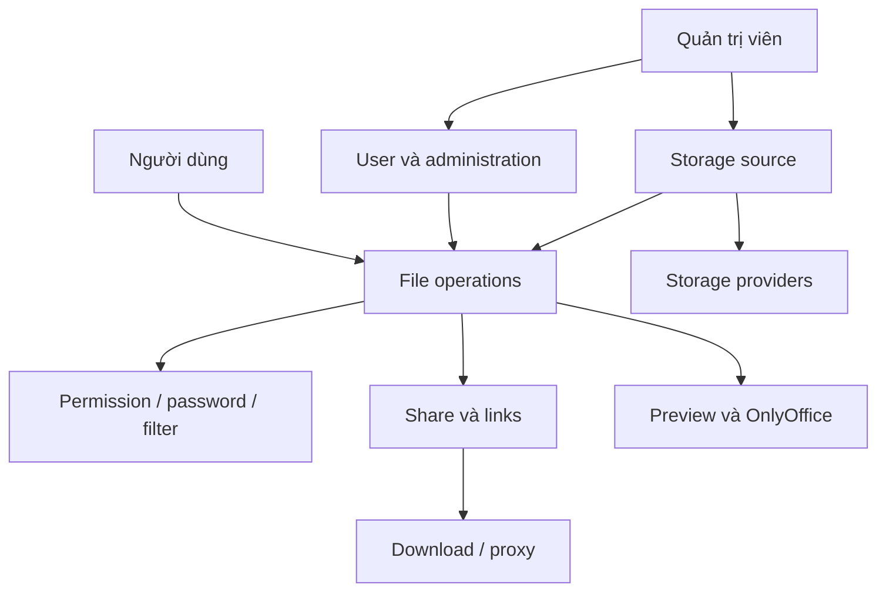

# Trạng thái tài liệu nghiệp vụ và kỹ thuật

Trang này ghi nhận cấu trúc hiện tại và những phần chưa được mã nguồn hoặc tài liệu trong repository xác minh. Người mới nên bắt đầu từ [Danh mục tính năng](../business/feature-catalog) hoặc [Lộ trình làm quen](../onboarding/start-here), không dùng trang trạng thái này làm lộ trình đọc.

Phần nghiệp vụ dành cho BA, PM và người vận hành; phần kỹ thuật dành cho lập trình viên và người đóng góp mã nguồn.

## Mục tiêu và phạm vi

Phạm vi nghiệp vụ của bộ tài liệu gồm cài đặt hệ thống, storage source, thao tác tệp, kiểm soát truy cập, chia sẻ, quản trị người dùng, cấu hình vận hành và tích hợp xem trước. [Mục đích hệ thống](../business/core/system-purpose) mô tả ranh giới sản phẩm; [Danh mục tính năng](../business/feature-catalog) dẫn đến từng chức năng.

Bộ tài liệu chỉ ghi nhận nội dung có bằng chứng từ tài liệu sản phẩm hoặc mã nguồn. Mỗi quy tắc, trạng thái, quyền và giới hạn phải trỏ đến tài liệu nội bộ hoặc file, class hay method nguồn. Khi chưa đủ bằng chứng, nội dung được ghi là **Chưa xác minh** thay vì suy luận.

## Nguyên tắc tổ chức

Nội dung dùng MDX, Mermaid và sidebar khai báo tường minh. Tài liệu đi theo miền nghiệp vụ để mô tả một tính năng từ mục đích đến mã nguồn, đồng thời có lộ trình làm quen:

Mỗi trang miền nghiệp vụ trả lời theo thứ tự `Why → What → How → Where in Code` và dùng các nhãn rõ ràng: **Yêu cầu nghiệp vụ**, **Quy tắc nghiệp vụ**, **Triển khai kỹ thuật**, **Chưa xác minh**.

## Cấu trúc đã có

| Vị trí | Nội dung hiện có | Trạng thái |
| --- | --- | --- |
| Trang mở đầu | Một trang chọn lộ trình đọc | Đã có |
| Business Core | 5 trang: mục đích, mô hình, truy cập và hiển thị, luồng cốt lõi, quy tắc và tình huống | Đã có |
| Business | Danh mục, tra cứu, installation, cấu hình vận hành và các miền chức năng | Đã có và nằm trong sidebar |
| Engineering | Tổng quan kiến trúc, điều hướng mã nguồn, dữ liệu và cấu hình, quy ước biên soạn | Đã có; chưa có ERD đã đối chiếu |
| Onboarding | Lộ trình bắt đầu và hướng dẫn chọn thay đổi đầu tiên | Đã có; chưa có quy trình chạy local đã kiểm chứng |
| Trạng thái tài liệu | Trang hiện tại | Đã có |
| `docs/superpowers/**` | Tài liệu làm việc nội bộ | Bị loại khỏi Docusaurus build |

## Cách dùng bộ tài liệu

1. Đọc [Mục đích hệ thống](../business/core/system-purpose) và [Mô hình nghiệp vụ](../business/core/business-model).
2. Dùng [Danh mục tính năng](../business/feature-catalog) để chọn miền cần tìm hiểu.
3. Đọc [Tổng quan kiến trúc](../engineering/architecture-overview), [Điều hướng mã nguồn](../engineering/code-navigation) và [Dữ liệu và cấu hình](../engineering/data-and-configuration) trước khi sửa mã.
4. Dùng [Lộ trình làm quen](../onboarding/start-here) và [Đóng góp đầu tiên](../onboarding/first-contribution) trong giới hạn các bước đã được mã nguồn xác nhận.

## Bản đồ miền nghiệp vụ

| Miền | Trách nhiệm | Vai trò chính | Điểm vào mã nguồn |
| --- | --- | --- | --- |
| Storage source | Khai báo, khởi tạo và bật/tắt backend lưu trữ | Quản trị viên | `StorageSourceService`, `StorageSourceContext` |
| File operations | Duyệt, tạo, sửa, di chuyển, sao chép, xóa và tải tệp | Người dùng, quản trị viên | `FileController`, `FileOperatorController`, `BaseFileService` |
| Access control | Quyền theo storage, folder password và filter | Người dùng, quản trị viên | `FileOperatorCheckAspect`, `CheckPasswordAspect` |
| Sharing & links | Chia sẻ theo key và tạo URL truy cập/tải | Người dùng, khách truy cập | `ShareLinkService`, `LinkDownloadService` |
| Identity & administration | Session, user, SSO, vai trò và cấu hình hệ thống | Quản trị viên, người dùng | `UserController`, `SsoService`, `SaTokenConfigure` |
| Preview & integrations | Xem trước nội dung và kết nối provider bên ngoài | Người dùng, dịch vụ ngoài | `onlyoffice` module, `StorageTypeEnum` |

## Nội dung chưa xác minh

- Chưa có ERD được đối chiếu với entity, mapper và migration hiện tại.
- Chưa có quy trình chạy local đã được thực hiện và kiểm chứng từ đầu đến cuối.
- Lệnh build backend duy nhất có căn cứ từ mã nguồn là `mvn clean package`. POM mặc định đặt `skipTests=true`, nên lệnh này không chạy test và không chứng minh ứng dụng khởi động được.
- Chưa tìm thấy `CONTRIBUTING`, mã kiểm thử, cấu hình Compose hoặc quy trình pull request trong nguồn dùng để biên soạn. Không bổ sung các bước này theo thông lệ của dự án khác.
- Metadata Maven/source hiện ghi `4.5.0`, trong khi repository và tài liệu sản phẩm cho thấy dòng 5.x. Chưa khẳng định phiên bản phát hành cho đến khi kiểm tra release pipeline hoặc artifact chính thức.
- Một số HTTP route được đăng ký runtime từ `system_config`; không thể liệt kê route thực tế mà không có configuration database tương ứng.
