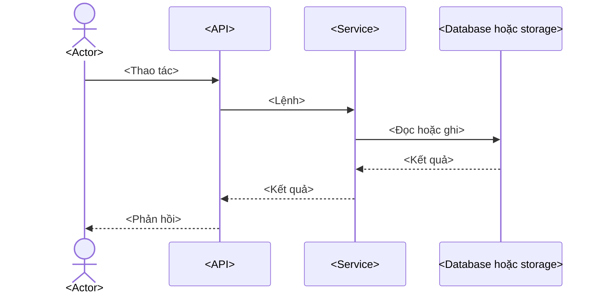

# <Tên domain>

<Domain này giúp actor nào làm việc gì.>

Phần nghiệp vụ dành cho BA, PM và người vận hành; phần **Ghi chú kỹ thuật** dành cho developer.

## Why

<Vấn đề và giá trị giải quyết, có source reference.>

## What

| Nội dung | Mô tả | Nguồn |
| --- | --- | --- |
| Actor | <Vai trò> | <URL hoặc file/class/method> |
| Use case | <Thao tác> | <URL hoặc file/class/method> |

## How

### Workflow

### Quy tắc và ngoại lệ

| Điều kiện | Kết quả | Nguồn |
| --- | --- | --- |
| <Điều kiện đã xác minh> | <Kết quả> | <URL hoặc file/class/method> |

## Where in Code

| Vai trò | Vị trí |
| --- | --- |
| Entry point | `<controller path>: <method>` |
| Business logic | `<service path>: <method>` |
| Persistence hoặc integration | `<entity/repository/provider path>` |

## Chưa xác minh

- <Dữ kiện thiếu source hoặc cần kiểm tra runtime.>
